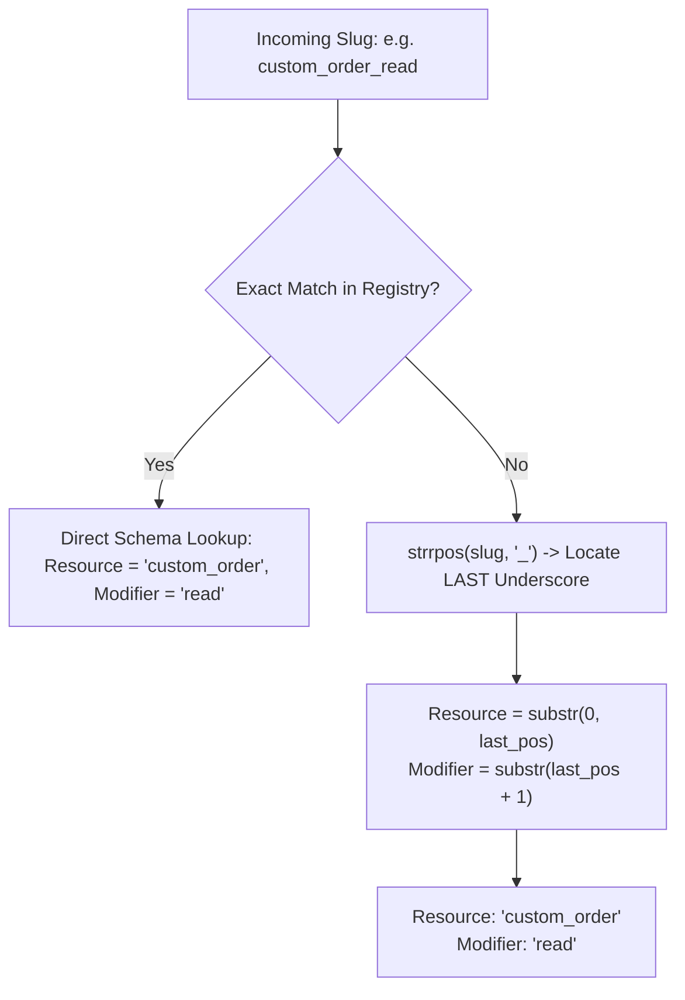
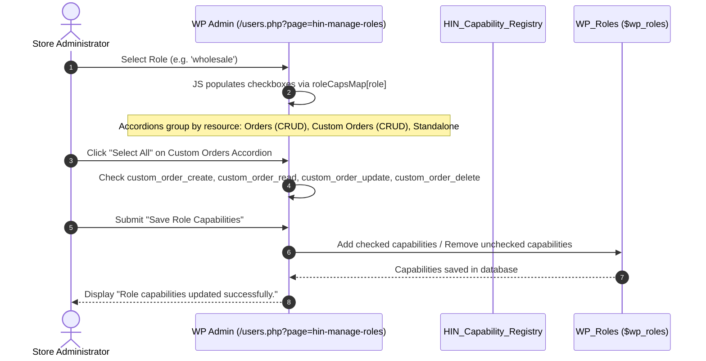

# Role Capabilities & Resource Authorization Flow

## 1. Overview & Architectural Goals

The **Handicraft Auth** plugin implements a fine-grained, resource-oriented **Role-Based & Attribute-Based Access Control (RBAC/ABAC)** system.

### Core Principles
1. **Standardized Naming Convention**: `<resource>_<modifier>` (e.g. `order_create`, `custom_order_read`).
2. **Explicit Resource Grouping**: Related CRUD actions are organized into collapsible accordion groups with quick toggles (*Select All / Clear*).
3. **Isolated Standalone Actions**: Non-CRUD capabilities (e.g. `dashboard_view`, `cart_add`, `profile_upgradeable`) are grouped distinctly from entity CRUD.
4. **Elimination of Generic Standalone `read`**: The legacy global `read` toggle has been completely removed from the manageable capability checklist.
5. **Unified Dual-Sided Enforcement**: Identical capability keys are validated on headless WordPress REST API endpoints and in the Nuxt 3 frontend.

---

## 2. Underscore Disambiguation Strategy

### The Multi-Underscore Challenge
When a resource contains an underscore (e.g., `custom_order`) and the modifier follows an underscore (e.g., `read`), the resulting slug is:
`custom_order_read`

If parsed naively by splitting on the first underscore, it would incorrectly split into:
- ❌ Resource: `custom`
- ❌ Modifier: `order_read`

### The Resolution Strategy



1. **Primary Strategy (Schema-Driven Registry)**:
   In [`HIN_Capability_Registry`](includes/services/class-capability-registry.php), capabilities are defined with explicit `resource` and `modifier` fields. Lookup is $O(1)$ and completely unambiguous:
   ```php
   'custom_order' => [
       'resource' => 'custom_order',
       'actions'  => [
           'read' => ['slug' => 'custom_order_read', 'modifier' => 'read'],
       ]
   ]
   ```

2. **Secondary Fallback (Break on LAST Underscore)**:
   For unknown, legacy, or custom dynamic capability slugs, parsing splits strictly on the **last underscore**:
   ```php
   $last_pos = strrpos($slug, '_');
   $resource = substr($slug, 0, $last_pos); // 'custom_order'
   $modifier = substr($slug, $last_pos + 1); // 'read'
   ```
   This guarantees that any multi-word resource (e.g. `sample_request_create` or `custom_order_update`) is safely and accurately decomposed into its resource and action components.

---

## 3. Capability Taxonomy Matrix

### 3.1 Grouped CRUD Resources

| Resource | Modifier | Full Capability Slug | Display Label | Description |
| :--- | :--- | :--- | :--- | :--- |
| **`order`** | `create` | `order_create` | Create Order | Place checkout orders |
| | `read` | `order_read` | View Orders | View personal order receipts and history |
| | `update` | `order_update` | Update Order | Modify shipping address / order notes |
| | `delete` | `order_delete` | Cancel / Delete Order | Cancel order or delete order records |
| **`custom_order`** | `create` | `custom_order_create` | Create Custom Order | Submit bespoke product quote inquiries |
| | `read` | `custom_order_read` | View Custom Orders | View submitted bespoke quotes and status |
| | `update` | `custom_order_update` | Update Custom Order | Revise quotation specifications or approve terms |
| | `delete` | `custom_order_delete` | Cancel Custom Order | Retract or cancel submitted quote request |

### 3.2 Standalone Capabilities (Non-CRUD)

| Resource | Modifier | Full Capability Slug | Display Label | Description |
| :--- | :--- | :--- | :--- | :--- |
| **`dashboard`** | `view` | `dashboard_view` | View Dashboard | Access headless dashboard navigation & stats |
| **`cart`** | `add` | `cart_add` | Add to Cart | Add products to cart and update quantities |
| **`profile`** | `edit` | `profile_edit` | Edit Profile | Edit user details and address book |
| **`profile`** | `upgradeable` | `profile_upgradeable` | Upgrade Profile | Eligible to upgrade account to wholesale |
| **`pricing`** | `wholesale_view` | `pricing_wholesale_view` | View Wholesale Pricing | View tiered wholesale pricing & MOQ rates |

---

## 4. End-to-End Request & Permission Flow

### 4.1 REST API Endpoint Authorization Flow

```mermaid
sequenceDiagram
    autonumber
    actor Client as Nuxt 3 Client
    participant API as WP REST API Route
    participant Security as HIN_Security_Handler
    participant Registry as HIN_Capability_Registry
    participant User as WP_User (Current User)

    Client->>API: HTTP Request + Bearer JWT Token
    Note over API: Route specifies: resource='custom_order', action='create'
    API->>Security: check_permission('custom_order', 'create')
    Security->>Security: Verify is_user_logged_in()
    alt Not Logged In
        Security-->>API: 401 Unauthorized
        API-->>Client: 401 Unauthorized
    else Logged In
        Security->>Registry: check_permission('custom_order', 'create', $user_id)
        Registry->>User: user_can($user, 'custom_order_create')
        alt Has Capability or Administrator
            Registry-->>Security: true
            Security-->>API: true
            API->>API: Execute Route Controller Logic
            API-->>Client: 200 / 201 Success Response
        else Missing Capability
            Registry->>User: Check backward-compatible aliases (e.g. 'request_custom_order')
            alt Alias Matches
                Registry-->>Security: true
                Security-->>API: true
                API-->>Client: 200 / 201 Success Response
            else No Permission
                Registry-->>Security: false
                Security-->>API: 403 Forbidden WP_Error
                API-->>Client: 403 Forbidden ("Requires custom_order_create")
            end
        end
    end
```



### 4.2 Admin Capability Management & Accordion Lifecycle



---

## 5. Route-to-Resource Declarations

Every REST route in the plugin explicitly declares its associated resource and capability in PHPDoc annotations and enforces it in its `permission_callback`:

```php
/**
 * @route      POST /wp-json/handicraft/v1/quotes
 * @resource   custom_order
 * @capability custom_order_create
 */
register_rest_route(self::NAMESPACE, '/quotes', [
    'methods'             => WP_REST_Server::CREATABLE,
    'callback'            => [$this, 'handle_submit_quote'],
    'permission_callback' => function () {
        return HIN_Security_Handler::check_permission('custom_order', 'create');
    },
]);
```

| File Path | Route Path | Method | Resource | Action | Enforced Capability |
| :--- | :--- | :---: | :--- | :--- | :--- |
| `routes/class-order-routes.php` | `/orders/my-orders` | `GET` | `order` | `read` | `order_read` |
| `post-types/class-quotes.php` | `/quotes` | `POST` | `custom_order` | `create` | `custom_order_create` |
| `post-types/class-quotes.php` | `/quotes` | `GET` | `custom_order` | `read` | `custom_order_read` |
| `post-types/class-quotes.php` | `/quotes/{id}` | `PUT` | `custom_order` | `update` | `custom_order_update` |
| `routes/class-auth-routes.php` | `/auth/me` | `PUT` | `profile` | `edit` | `profile_edit` |
| `routes/class-auth-routes.php` | `/auth/upgrade` | `POST` | `profile` | `upgradeable` | `profile_upgradeable` |

---

## 6. Frontend Integration & Compatibility

### 6.1 Bidirectional Alias Mapping in Pinia Store
In `frontend/app/stores/auth.ts`, `hasCapability()` transparently resolves both new canonical keys and existing legacy keys:

```ts
const CAPABILITY_ALIASES: Record<string, string[]> = {
  dashboard_view: ['view_dashboard'],
  order_read: ['view_order'],
  custom_order_create: ['request_custom_order'],
  custom_order_read: ['view_quote'],
  cart_add: ['add_to_cart'],
  profile_edit: ['update_address'],
  pricing_wholesale_view: ['view_wholesale_pricing'],
}
```

### 6.2 Template Composable Usage
```vue
<template>
  <!-- Show cart only if permitted -->
  <button v-if="can('cart_add') || !isAuthenticated" @click="openCart">Cart</button>

  <!-- Show dashboard overview -->
  <NuxtLink v-if="can('dashboard_view')" to="/dashboard">Dashboard</NuxtLink>
</template>
```

### 6.3 Route-Level Middleware Protection
```ts
// Nuxt 3 Page Meta (ABAC Guard)
definePageMeta({
  middleware: 'auth',
  capabilities: ['pricing_wholesale_view']
})
```
